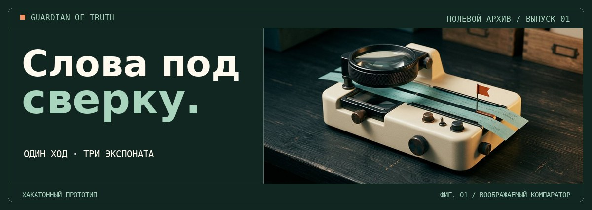
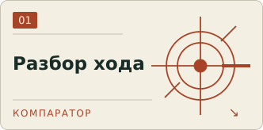
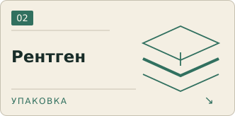
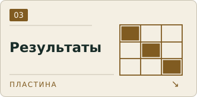
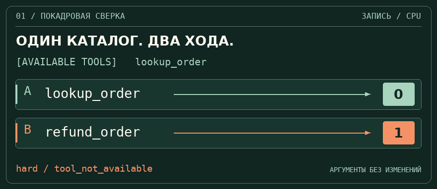
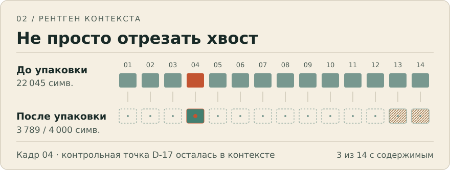
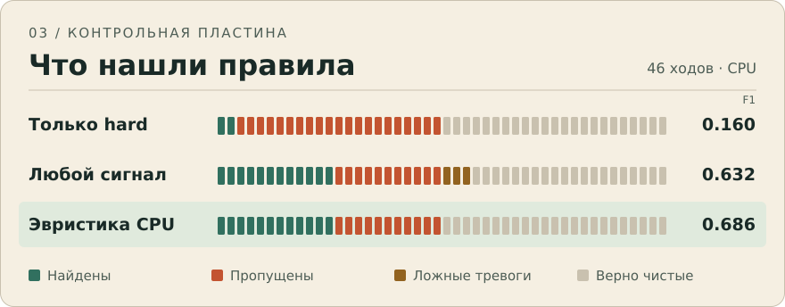
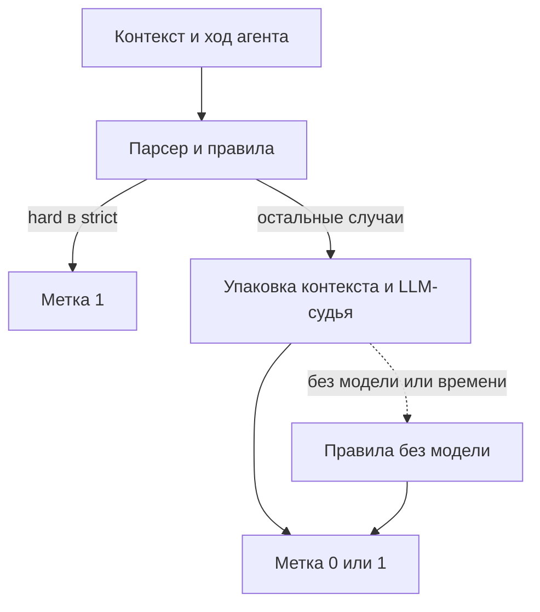

# Guardian of Truth

<p><a href="#демо"><picture>
  <source media="(max-width: 600px)" srcset="docs/assets/showcase/archive-cover-compact.jpg">
  
</picture></a></p>

**Хакатонный проект · Python · vLLM · Docker.** Детектор контекстных галлюцинаций LLM-агентов. Он сверяет один ход с тем, что агент видел: репликами, политикой и ответами инструментов. На входе — `prompt` и `response`, на выходе — `label`: `1`, если найдена галлюцинация, и `0`, если не найдена. Веса проверяемого агента и эталонное поле `explanation` не используются.

<p align="center"><a href="#демо"></a><a href="#рентген-контекста"></a><a href="#результаты"></a></p>

[01 · Разбор хода](#демо) · [02 · Рентген](#рентген-контекста) · [03 · Результаты](#результаты) · [Как устроено](#архитектура) · [Запуск](#запуск)

**[Скачать интерактивную лабораторию (.zip) ↓](docs/assets/showcase/guardian-lab.zip?raw=true)** Разархивируйте и откройте `index.html` в браузере. Там можно сверить три записанных хода, двигать ползунок бюджета и переключать режимы правил. Всё работает без сети, а данные посчитаны реальным CPU-детектором заранее.

## Демо

**01 / Компаратор.** Пользователь спрашивает: «Где заказ `#W1042087`?» В каталоге есть только `lookup_order`. Посмотрите, что произойдёт, если поменять **имя вызова**, не трогая аргументы.

<p><a href="docs/assets/showcase/audit-replay.gif"><picture>
  <source media="(prefers-reduced-motion: reduce)" srcset="docs/assets/showcase/audit-replay-still.png">
  
</picture></a></p>

На одном и том же запросе `lookup_order` получает `0`, а `refund_order` — `1` (`tool_not_available`, уровень `hard`). Это [две синтетические записи](tests/fixtures/portfolio_demo.jsonl), не настоящие заказы. Guardian проверяет запись хода, **не выполняя** вызов.

<details>
<summary><b>А если инструмент настоящий, но номер заказа подменили?</b></summary>

В третьей кассете лаборатории `lookup_order` получает `#W1991420`. Инструмент объявлен, но номера нет в контексте: срабатывает `ungrounded_argument`, и CPU-детектор снова выдаёт `1`. Так можно отдельно проверить имя вызова и его данные.

[Карточка сигнала для первого опыта (SVG)](docs/assets/evidence-plate.svg) · [Запустить два исходных примера](#запуск)

</details>

## Рентген контекста

**02 / Упаковка.** Под проверкой ответ про заказ с контрольной точкой `D-17`. В журнале 14 ответов инструментов; нужная улика — в **четвёртом**, а не в последнем. Простое усечение начала потеряло бы её.

[](docs/assets/showcase/context-xray.svg)

На этом примере [`build_evidence`](src/guardian/evidence.py) укладывает **22 045 → 3 789 символов** в бюджет 4 000. Содержимое осталось у трёх ответов из 14, в том числе у источника `D-17`. У остальных здесь стоят маркеры пропуска. Выставка показывает конкретный случай, а не обещание, что упаковка всегда сохраняет все важные детали.

<details>
<summary><b>Как читать пластины</b></summary>

По горизонтали — порядок ответов в истории. В нижней полосе сплошная ячейка означает полный ответ, штриховка — укороченный, контур с точкой — только маркер `[omitted to fit context]`. В лаборатории можно открыть каждый кадр до и после упаковки. Доступные бюджеты: 4 000, 8 000, 16 000 и 30 000 символов; это четыре прогона упаковщика на одном синтетическом журнале.

</details>

## Результаты

**03 / Контрольная пластина.** Один штрих — один ход. Сравните, где правила пропускают ошибки, а где поднимают лишнюю тревогу.

<p><a href="docs/assets/showcase/scorecard.csv"><picture>
  <source media="(prefers-color-scheme: dark)" srcset="docs/assets/showcase/score-sheet-dark.svg">
  
</picture></a></p>

На [размеченном срезе из репозитория](valid.parquet) 46 ходов, из них 23 с галлюцинациями. Все измерения ниже — на CPU, без LLM.

| Режим | Precision | Recall | F1 |
| --- | ---: | ---: | ---: |
| Только жёсткие сигналы | 1.000 | 0.087 | 0.160 |
| Любой сигнал | 0.800 | 0.522 | 0.632 |
| **Эвристика (`--backend heuristic`)** | **1.000** | **0.522** | **0.686** |

Эвристика нашла 12 из 23 ошибок без ложных срабатываний, но пропустила 11. Этот же небольшой срез использовался для настройки правил. Это не независимый тест, не замер LLM-судьи и не результат лидерборда.

[Открыть числа в CSV](docs/assets/showcase/scorecard.csv) · [Воспроизвести замер](reports/README.md) · [Скачать печатный лист проекта (PDF)](docs/assets/showcase/field-sheet.pdf)

## Архитектура



1. **Правила проверяют структуру.** Парсер извлекает каталог, вызовы и ответы инструментов. `hard` в режиме `strict` сразу даёт `1`; неоднозначные `soft`-сигналы — подсказки судье.
2. **Локальный судья проверяет смысл.** `Qwen2.5-14B-Instruct-AWQ` читает контекст до 30 000 символов и ищет противоречия и утверждения без опоры. При наличии времени для метки `0` предусмотрено второе мнение.
3. **Под дедлайн детектор сокращает контекст.** Если судья не загрузился или бюджет времени закончился, остаются правила. Сабмит сохраняет исходные `id` и пишет метки в Parquet.

[Разбор сигналов, упаковки и промптов →](docs/APPROACH.md)

## Запуск

Нужен **Python 3.10+**. Для этого демо не нужны GPU, веса или ключи API.

```bash
git clone https://github.com/overbaffe1/Guardian-of-Truth.git
cd Guardian-of-Truth
python -m venv .venv
source .venv/bin/activate
python -m pip install .
```

На Windows (PowerShell) вместо `source` используйте `.venv\Scripts\Activate.ps1`.

```bash
python scripts/predict.py --backend heuristic --input tests/fixtures/portfolio_demo.jsonl --output predictions.parquet
python -c "import pandas as pd; print(pd.read_parquet('predictions.parquet').to_string(index=False))"
```

```text
           id  label
  listed-tool      0
invented-tool      1
```

<details>
<summary>Посмотреть, какой сигнал сработал</summary>

```bash
python scripts/inspect_example.py --input tests/fixtures/portfolio_demo.jsonl --id invented-tool
```

В блоке `signals` появится `[hard] tool_not_available`: вызов `refund_order` отсутствует в `[AVAILABLE TOOLS]`.

</details>

## Исходники и артефакты

- **Инженерия:** [запуск на GPU и калибровка](docs/RUNBOOK.md) · [формат сабмита](docs/SUBMISSION.md) · [архив хакатона](https://github.com/overbaffe1/Guardian-of-Truth/releases/tag/submission-20261018-2115). Веса опубликованы в составе архива частями, не хранятся в Git.
- **Витрина:** [как пересобрать экспонаты](docs/showcase/README.md) · [печатный лист A4](docs/assets/showcase/field-sheet.pdf) · [карточка ссылки 1280 × 640](docs/assets/showcase/share-card.jpg). Идея триптиха и печатных артефактов — из [мастерской `gitEdit`](https://github.com/overbaffe1/gitEdit).

[](https://github.com/overbaffe1/Guardian-of-Truth/actions/workflows/ci.yml) · Лицензия кода: [MIT](LICENSE).
