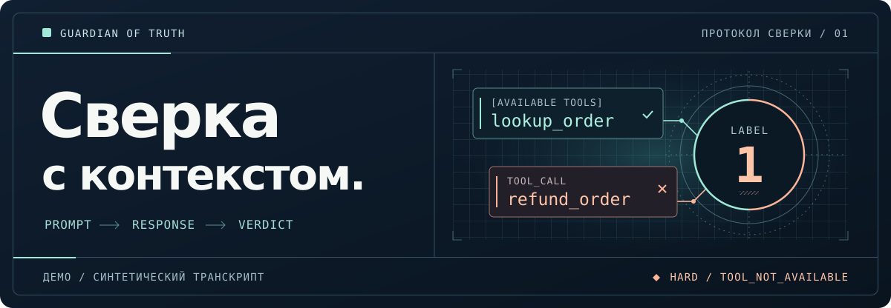
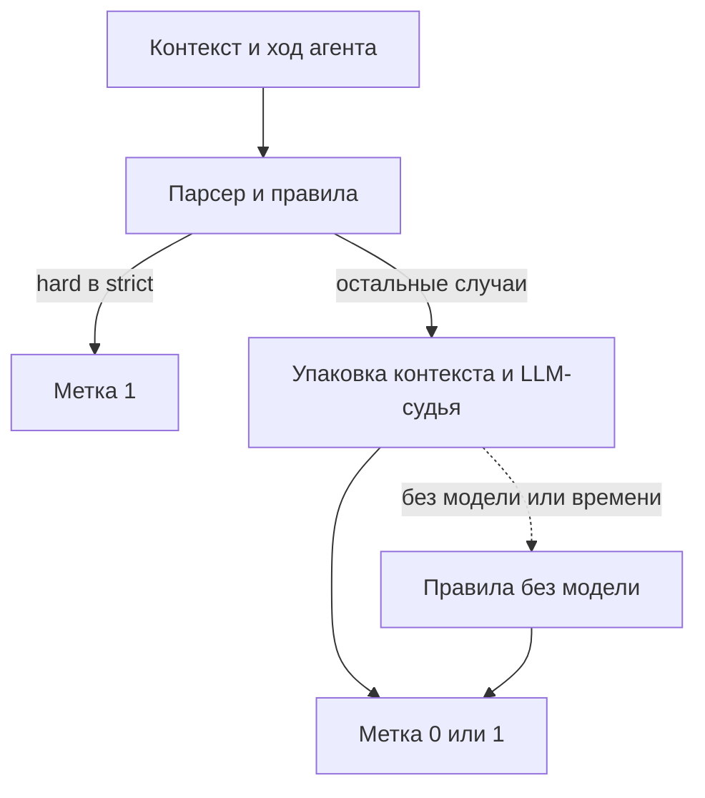

# Guardian of Truth

**Хакатонный проект · Python · vLLM · Docker**

**Детектор контекстных галлюцинаций LLM-агентов.** Сверяет слова и действия агента с тем, что он видел: диалогом, правилами и ответами инструментов. На входе — контекст (`prompt`) и один ход (`response`), на выходе — `label`: `1`, если детектор нашёл галлюцинацию, и `0`, если не нашёл. Веса проверяемого агента и эталонное поле `explanation` не используются.

[](#демо)

[Демо](#демо) · [Архитектура](#архитектура) · [Результаты](#результаты) · [Запуск](#запуск) · [Документация](#документация)

## Демо

Пользователь спрашивает: «Где заказ `#W1042087`?» В каталоге инструментов есть `lookup_order`, но нет `refund_order`. В [двух синтетических записях](tests/fixtures/portfolio_demo.jsonl) меняется только имя вызванного инструмента:

| Ход агента | Метка | Объяснение |
| --- | :---: | --- |
| `lookup_order` | `0` | Инструмент есть в каталоге, номер заказа — в запросе. |
| `refund_order` | `1` | Инструмента нет в каталоге: `tool_not_available` (`hard`). |

Guardian разбирает запись хода, а не выполняет вызов. Оба вердикта можно получить [локально без модели](#запуск).

## Архитектура



1. **Структурные ошибки проверяются правилами.** Парсер извлекает каталог, вызовы и результаты инструментов. Однозначные сигналы (`hard`) в режиме `strict` сразу дают `1`; сомнительные (`soft`) помогают судье, но по умолчанию не переопределяют его вердикт.
2. **Смысл проверяет локальный LLM-судья.** Политика, диалог и релевантные результаты инструментов упаковываются в бюджет до 30 000 символов. `Qwen2.5-14B-Instruct-AWQ` ищет противоречия и утверждения без опоры; для метки `0` предусмотрено второе мнение, если хватает времени.
3. **Если судья недоступен, остаются правила.** Под дедлайн площадки пайплайн сокращает контекст, а для оставшихся примеров может перейти в эвристический режим. Сабмит сохраняет исходные `id` и пишет метки в Parquet.

[Разбор сигналов, упаковки и промптов →](docs/APPROACH.md)

## Результаты

На [размеченном срезе из репозитория](valid.parquet): **46 ходов, из них 23 с галлюцинациями**. Все измерения ниже — на CPU, без LLM.

| Режим | Precision | Recall | F1 |
| --- | ---: | ---: | ---: |
| Только жёсткие сигналы | 1.000 | 0.087 | 0.160 |
| Любой сигнал | 0.800 | 0.522 | 0.632 |
| **Эвристический режим (`--backend heuristic`)** | **1.000** | **0.522** | **0.686** |

Эвристика нашла **12 из 23** ошибок без ложных срабатываний, но пропустила 11. Этот же небольшой срез использовался для настройки правил. Это не независимый тест, не замер LLM-судьи и не результат лидерборда.

[Отчёты и команды для воспроизведения →](reports/README.md)

## Запуск

Нужен **Python 3.10+**. Для этого демо не нужны GPU, веса или ключи API.

```bash
git clone https://github.com/overbaffe1/Guardian-of-Truth.git
cd Guardian-of-Truth
python -m venv .venv
source .venv/bin/activate
python -m pip install .
```

На Windows (PowerShell) вместо `source` используйте `.venv\Scripts\Activate.ps1`.

```bash
python scripts/predict.py --backend heuristic --input tests/fixtures/portfolio_demo.jsonl --output predictions.parquet
python -c "import pandas as pd; print(pd.read_parquet('predictions.parquet').to_string(index=False))"
```

```text
           id  label
  listed-tool      0
invented-tool      1
```

<details>
<summary>Посмотреть, какой сигнал сработал</summary>

```bash
python scripts/inspect_example.py --input tests/fixtures/portfolio_demo.jsonl --id invented-tool
```

В блоке `signals` появится `[hard] tool_not_available`: вызов `refund_order` отсутствует в `[AVAILABLE TOOLS]`.

</details>

## Документация

- [Подход](docs/APPROACH.md) — парсер, сигналы, упаковка контекста и рубрика судьи.
- [Руководство по запуску](docs/RUNBOOK.md) — Docker и GPU, диагностика, калибровка и тесты.
- [Формат сабмита](docs/SUBMISSION.md) — офлайн-среда, ZIP64 и Parquet вместо CSV. [Архив хакатона](https://github.com/overbaffe1/Guardian-of-Truth/releases/tag/submission-20261018-2115) опубликован в GitHub Releases частями; весов в Git нет.

[](https://github.com/overbaffe1/Guardian-of-Truth/actions/workflows/ci.yml) · Лицензия кода: [MIT](LICENSE).
